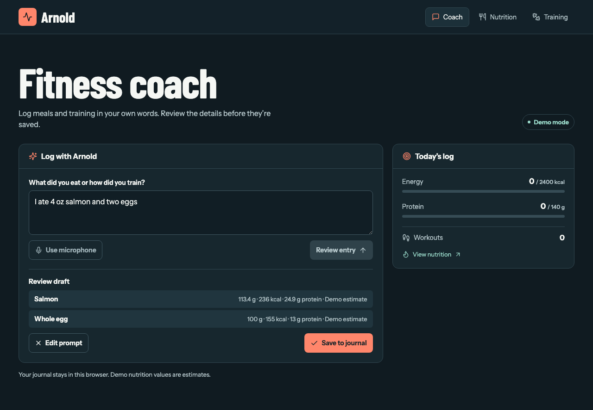

# Arnold

Arnold is a voice and text fitness journal. Describe what you ate or how you trained, check what Arnold understood, and save the entry to see your daily totals. The demo runs without any API keys.



## Try the demo

You’ll need Node.js 22 or newer and npm.

```sh
git clone https://github.com/Thaarak/arnold-showcase.git
cd arnold-showcase
npm ci
npm run dev
```

Open [127.0.0.1:3000](http://127.0.0.1:3000). Select **Log a meal**, click **Review entry**, then **Save to journal**. In **Nutrition**, check the saved entries and update your daily targets. In **Training**, search the sample exercise library or log a completed session.

[See the saved meal in Nutrition](docs/nutrition-log.png).

The demo uses a built-in food and exercise catalog. Nutrition values are estimates. Entries and goals stay in your browser and survive a refresh. You can add entries manually and remove them from the journal. Microphone input depends on your browser’s speech recognition and permissions. Your browser may process dictation through its speech provider. The coach also supports typed input and can read replies aloud when a local system voice is available.

## What I built

I extended our hackathon prototype with plain-English meal and workout tracking, USDA food lookup, wger exercise search, and a voice interaction flow. In this showcase, I rebuilt the logging flow so it previews portions and nutrients before saving, converts ounces to grams, and records each confirmed batch once. I also added a self-contained demo and a mobile layout.

The web app uses Next.js, React, and TypeScript. IndexedDB saves the journal. Optional Next.js routes connect to live providers using server-side credentials.

## Optional local integrations

Copy `.env.example` to `.env.local`, set `ARNOLD_ENABLE_LIVE=true`, configure the services you want, and restart Arnold. Use the loopback address from `npm run dev`.

| Service | Configuration |
| --- | --- |
| USDA FoodData Central | `USDA_API_KEY`. Food queries with a known portion can use USDA results. Sample estimates remain available when lookup fails. |
| OpenAI | `OPENAI_API_KEY`. Used for general coaching replies. Logging still goes through the same review and confirmation flow. |
| ElevenLabs | `ELEVENLABS_API_KEY` and `ELEVENLABS_VOICE_ID` for a voice you’re authorized to use. Playback can fall back to a local system voice. |
| wger | Exercise search uses the public catalog in local live mode and falls back to the demo library if unavailable. |

The demo is intended for portfolio visitors. Keep the optional integrations on your own machine. Live requests send the relevant query or text to the configured provider.

Run `npm test`, `npm run typecheck`, and `npm run build` to check the app.

## Credits

Thaarak Sriram, [Shrish](https://github.com/ShrishPremkrishna), Kenny, and Jello built the original Arnold together at the MCP AI Agent Hackathon in July 2025.

- **Shrish** built the original Python backend and experimented with MongoDB and Bright Data.
- **Kenny** and **Jello** helped build the original hackathon prototype.
- **[@jiale-z](https://github.com/jiale-z)** added a Temporal worker to the original project.
